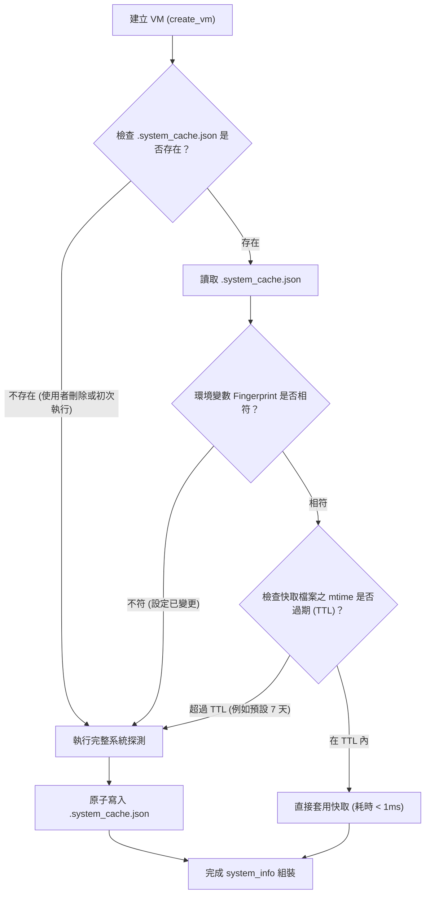

# peforth System Info Probing Cache 計劃書

**目標：**

解決 peforth 在建立 VM（`create_vm()`）時，因同步執行外部程序探測系統環境資訊（`_detect_system_info()`）所造成的嚴重啟動延遲。透過在使用者設定目錄下建立持久化的系統資訊快取檔案（`.system_cache.json`），結合 TTL（有效期限）與環境設定指紋檢測，將 REPL 與 CLI 的冷啟動延遲由原本的秒級（1.2 ~ 3.5 秒）降低至 50 毫秒以內。

**範圍：**

本計劃主要調整 `peforth/repl.py` 中的 `_detect_system_info()` 及相關 shell/tool 探測函式（`_pwsh_info`、`_windows_wsl_info`、`_program_info`），並提供專屬的快取讀寫、驗證與失效更新機制。不修改 Forth 核心字典、TIB、tokenizer、AI bridge 通訊協定或 SQLite 診斷日誌之 schema。

---

## 一、現狀問題與效能瓶頸

### 1. 瓶頸現況
在現行實作中，每次執行 `f` 指令或呼叫 `create_vm()` 時，系統都會無條件同步探測所有支援的 shell 與 host 工具：

- **WSL 環境**：
  在 `_pwsh_info()` 中，為探測 Windows PowerShell，會跨環境呼叫 Windows 原生執行檔：
  `pwsh.exe -NoLogo -NoProfile -NonInteractive -Command "$PSVersionTable.PSVersion.ToString()"`
  跨 OS interop 啟動行程非常耗時，**實測耗時 0.7 ~ 1.2 秒**，佔整個 process 啟動時間 90% 以上。
- **Windows 環境**：
  在 `_windows_wsl_info()` 中，會呼叫 `wsl.exe --list --quiet` 與 `wsl.exe -d Ubuntu --exec bash --version`。
  Windows 喚醒 WSL 虛擬化子系統**實測耗時高達 2.0 ~ 3.5 秒**。

### 2. 探測結果的高度靜態特性
一般開發機上的 PowerShell 版本、WSL distro 分布、bash 與 curl 版本極少在短期內頻繁變動。每次 REPL 啟動皆重新 fork process 查詢，造成不必要的重複開銷。

---

## 二、快取架構與儲存位置

### 1. 儲存位置
快取檔案命名為 `.system_cache.json`，存放於 `ai_bridge._runtime_config_path()` 所解析的目錄（沿用 `PEFORTH_CONFIG_DIR`，預設為各環境的使用者目錄）：

```text
WSL:     ~/.peforth/.system_cache.json
Windows: %USERPROFILE%\.peforth\.system_cache.json
```

**遵循原則：**
- **Keep caller and target separate**：WSL 與 Windows 各自維護自己的快取檔，不跨檔案系統共享，避免路徑格式（`/mnt/c` vs `C:\`）混淆與並行寫入鎖定問題。
- **原子性寫入（Atomic Write）**：寫入快取時先寫入同目錄下的暫存檔（例如 `.system_cache.json.tmp.<pid>`），再以 `os.replace` 取代，避免並行多個 peforth process 讀取到寫入未完成的破裂 JSON。

---

## 三、快取資料格式（Cache Schema）

快取檔案採用 JSON 格式儲存，並標註版本號與產生時戳：

```json
{
  "schema_version": 1,
  "created_at": "2026-10-19T03:15:00.000000+00:00",
  "environment": "wsl",
  "config_fingerprint": {
    "PEFORTH_PWSH_PATH": "",
    "PEFORTH_WSL_DISTRO": ""
  },
  "shells": {
    "pwsh": {
      "available": true,
      "path": "/mnt/c/Program Files/PowerShell/7/pwsh.exe",
      "version": "7.5.3",
      "execution_host": "windows",
      "source": "path"
    },
    "bash": {
      "available": true,
      "path": "/usr/bin/bash",
      "version": "GNU bash, version 5.2.21(1)-release"
    },
    "curl": {
      "available": true,
      "path": "/usr/bin/curl",
      "version": "curl 8.5.0"
    }
  },
  "wsl": {
    "available": true,
    "path": null,
    "distro": "Ubuntu",
    "distros": []
  }
}
```

**欄位說明：**
- `schema_version`：快取格式版本號，若程式升級導致結構改變時可直接判定舊快取失效。
- `created_at`：快取建立之 UTC ISO 8601 時戳。
- `environment`：記錄當時產生的作業系統環境（`"wsl"` 或 `"windows"`）。
- `config_fingerprint`：記錄影響探測結果的關鍵環境變數設定值（`PEFORTH_PWSH_PATH` 與 `PEFORTH_WSL_DISTRO`）。
- `shells`、`wsl`：探測所得之靜態 shell 及 WSL 分布資訊。

---

## 四、快取失效與更新策略（Cache Invalidation & Refresh Policy）

維持設計簡潔、不向外多餘干涉其他檔案系統屬性，快取採用簡潔可靠的**三項驗證規則**：



### 1. TTL（Time-To-Live，太舊失效）
- 依據 `.system_cache.json` 檔案本身的 `st_mtime`（最後修改時間）。
- 預設有效期限為 **7 天（604,800 秒）**。
- 可透過環境變數 `PEFORTH_CACHE_TTL` 自訂有效秒數；若設定 `PEFORTH_CACHE_TTL=0` 則等同停用快取每次重測。
- 判斷式：
  $$\text{目前時間} - \text{cache\_file.stat().st\_mtime} > \text{PEFORTH\_CACHE\_TTL}$$
  若超過 TTL，代表資料過舊，自動觸發重測並覆寫快取。

### 2. 環境變數指紋（Fingerprint）異動檢測
- 若使用者變更了 `.env` 或環境變數中的 `PEFORTH_PWSH_PATH` 或 `PEFORTH_WSL_DISTRO`，與快取紀錄之 `config_fingerprint` 不符時，立即判定失效並重測。

### 3. 手動刷新方式（極簡設計）
- **無須額外設定手動刷新參數**：若使用者升級了 PowerShell 或系統環境想強制刷新快取，只需直接將 `.system_cache.json` 檔案刪除，下一次啟動時偵測不到檔案即會自動進行全新探測並重建快取。

---

## 五、新增環境變數說明

| 環境變數 | 預設值 | 說明 |
| :--- | :--- | :--- |
| `PEFORTH_CACHE_TTL` | `604800` | 系統資訊快取的存活秒數（預設 7 天 = 604,800 秒）。若設為 `0` 則停用快取、每次啟動皆重新探測。 |

---

## 六、例外處理與優雅降級（Fallback & Safety）

1. **讀取錯誤容錯**：
   若快取檔案遭遇 JSON 毀損、權限不足（`PermissionError`）或格式版本不合，一律抑制例外並優雅降級為全量探測，不中斷 REPL 啟動。
2. **寫入失敗容錯**：
   若因唯讀檔案系統或權限限制無法寫入快取檔，僅於偵錯時忽略，不引發例外中斷主流程。
3. **動態資訊不快取**：
   `sys.executable`、`platform.python_version()`、虛擬環境啟用狀態（`venv_active`）以及即時工作目錄等輕量且與當前 process 綁定的屬性，仍由當前執行緒即時填入，不寫入快取。

---

## 七、實施步驟與驗收

### 步驟 1：更新 `.env.example`
在 `.env.example` 中加入 `PEFORTH_CACHE_TTL` 說明。

### 步驟 2：在 `peforth/repl.py` 實作快取邏輯
1. 實作 `_system_cache_path()`。
2. 實作 `_load_system_cache(cache_path, current_env, fingerprint, ttl)` 與 `_save_system_cache(cache_path, data)`。
3. 改造 `_detect_system_info()`：若快取命中且有效則直接套用 `shells` 與 `wsl`，跳過耗時的外部指令。

### 步驟 3：撰寫自動化測試（`tests/test_system_cache.py`）
1. 初次建立快取並成功寫入。
2. 二次啟動命中快取且不呼叫 subprocess。
3. 刪除快取檔案後能自動重新生成。
4. TTL 到期後自動重測。
5. Fingerprint 變更自動重測。
6. 快取內容損毀時優雅降級。
