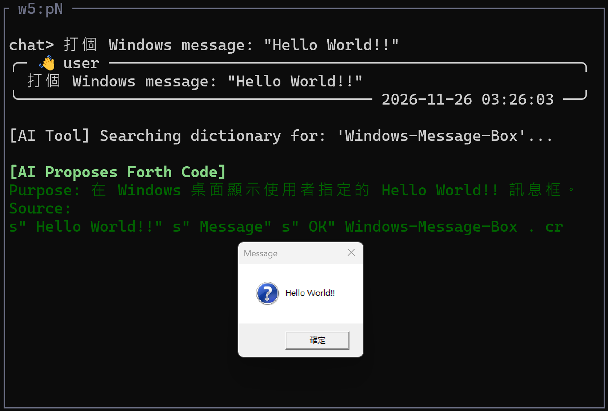

# Tour Guide: Showing a Windows Message Box

This tour guide demonstrates how peforth can discover and invoke a Windows message-box word, then explain the Forth command and its parameter order. The transcript below is reproduced verbatim from the Herdr pane.

## Conversation

```text
chat> 打個 Windows message: "Hello World!!"
╭─ 👋 user ────────────────────────────────────────────────────╮
  打個 Windows message: "Hello World!!"
╰─────────────────────────────────────── 2026-11-26 03:26:03 ──╯

[AI Tool] Searching dictionary for: 'Windows-Message-Box'...

[AI Proposes Forth Code]
Purpose: 在 Windows 桌面顯示使用者指定的 Hello World!! 訊息框。
Source:
s" Hello World!!" s" Message" s" OK" Windows-Message-Box . cr

{'exit_code': 0, 'stdout': 'OK', 'stderr': ''}

╭─ 🪄 peforth ────────────────────────── OpenAI │ gpt-6-luna ──╮
  Windows 訊息框已顯示 **“Hello World!!”**，並收到 **OK** 回應。
╰─────────────────────────────────────── 2026-11-26 03:29:12 ──╯
```



```text
chat> 怎麼樣下命令做出這個動作？
╭─ 👋 user ────────────────────────────────────────────────────╮
  怎麼樣下命令做出這個動作？
╰─────────────────────────────────────── 2026-11-26 03:29:42 ──╯

╭─ 🪄 peforth ────────────────────────── OpenAI │ gpt-6-luna ──╮
  在 peforth (前導 '/' 暫時從 chat mode 切換成 forth mode) 裡可以這樣下命令：

  '''forth
  / s" Hello World!!" s" Message" s" OK" Windows-Message-Box
  '''

  參數順序是 **訊息、標題、按鈕類型**。例如上面的命令會顯示內容為 `Hello World!!`、標題為 `Message`、附有 `OK` 按鈕的 Windows 對話框。

  若想在 Forth stack 上查看按鈕結果，可以加上 `. cr`：

  '''forth
  / s" Hello World!!" s" Message" s" OK" Windows-Message-Box . cr
  '''
╰─────────────────────────────────────── 2026-11-26 03:29:45 ──╯
chat>
```

## What this demonstrates

- The AI searches the dictionary for the relevant Windows message-box word.
- It proposes and runs a Forth expression that supplies the message, title, and button type.
- The interaction then explains the command syntax and parameter order, including how to print the returned button result.

The conversation transcript is preserved as captured; the explanatory section is added as tour-guide context.

## Try it

Ask peforth: `打個 Windows message: "Hello World!!"`

Or enter the Forth command directly:

```forth
/ s" Hello World!!" s" Message" s" OK" Windows-Message-Box
```
