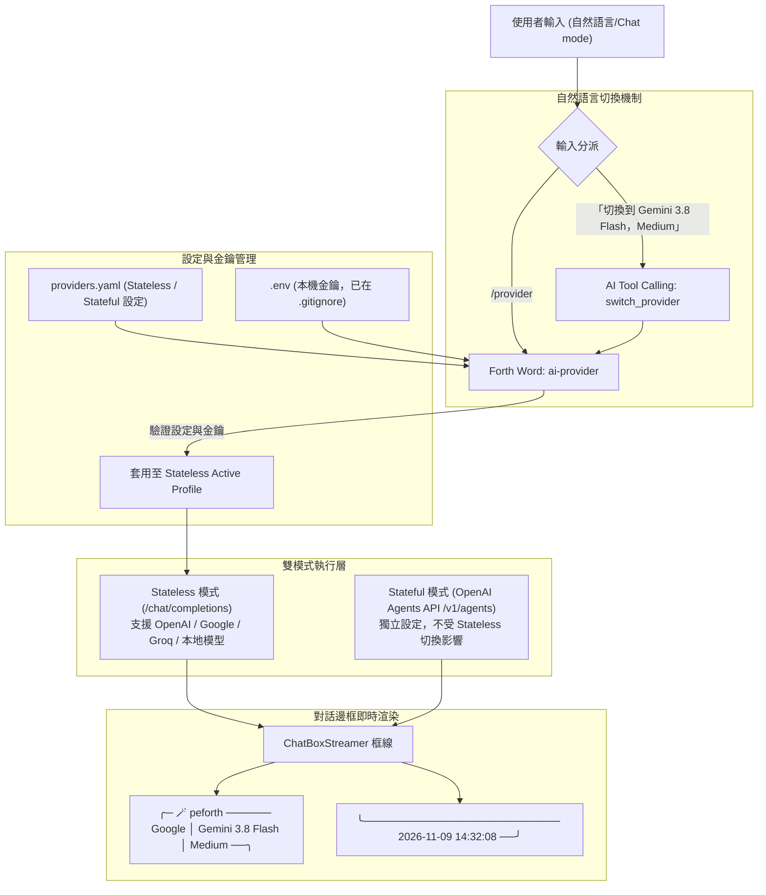

# peforth 多 Provider 支援架構與實作計劃書

本計劃書針對 peforth 2.1 實作多 Provider 支援架構，讓使用者能透過自然語言即時切換不同的 AI 供應商、模型與推理層級（Reasoning Effort），並在對話框線上即時呈現當前 Provider、Model、Reasoning 及回覆時間戳記。

---

## 1. 系統架構設計



---

## 2. YAML 設定結構 (`providers.yaml`)

於專案目錄及 `~/.peforth/providers.yaml` 支援 Provider 設定，**Stateless** 與 **Stateful** 完全分開，金鑰一律從環境變數 / `.env` 讀取，絕不寫入 YAML：

```yaml
# peforth AI Providers Configuration

# Stateful 模式專用：固定使用 OpenAI Agents API (/v1/agents/sessions)
stateful:
  provider: "OpenAI"
  endpoint: "https://api.openai.com/v1"
  model: "gpt-4o"
  api_key_env: "OPENAI_API_KEY"

# Stateless 模式：支援所有 OpenAI 相容之 Chat Completions endpoint
stateless:
  default_profile: "openai-gpt-4o-mini"
  
  profiles:
    openai-gpt-4o-mini:
      provider: "OpenAI"
      endpoint: "https://api.openai.com/v1"
      model: "gpt-4o-mini"
      reasoning: "none"
      api_key_env: "OPENAI_API_KEY"
      aliases: ["gpt-4o-mini", "4o-mini", "openai"]

    openai-o3-mini:
      provider: "OpenAI"
      endpoint: "https://api.openai.com/v1"
      model: "o3-mini"
      reasoning: "medium"
      api_key_env: "OPENAI_API_KEY"
      aliases: ["o3-mini", "o3"]

    google-gemini-3.8-flash:
      provider: "Google"
      endpoint: "https://generativelanguage.googleapis.com/v1beta/openai/"
      model: "gemini-3.8-flash"
      reasoning: "Medium"
      api_key_env: "GEMINI_API_KEY"
      aliases: ["Gemini 3.8 Flash", "gemini-flash", "gemini", "google"]

    groq-llama-3.3-70b:
      provider: "Groq"
      endpoint: "https://api.groq.com/openai/v1"
      model: "llama-3.3-70b-versatile"
      reasoning: "none"
      api_key_env: "GROQ_API_KEY"
      aliases: ["groq", "llama-3.3"]

    ollama-local:
      provider: "Ollama"
      endpoint: "http://localhost:11434/v1"
      model: "llama3"
      reasoning: "none"
      api_key_env: "OLLAMA_API_KEY"  # 本地模型通常無需金鑰
      aliases: ["ollama", "local"]
```

---

## 3. 金鑰與本機環境安全 (`.env`)

- 所有 API 金鑰存放在本機 `.env`（或 `~/.peforth/.env`）：
  ```bash
  OPENAI_API_KEY="sk-..."
  GEMINI_API_KEY="AIza..."
  GROQ_API_KEY="gsk_..."
  ```
- 確認 `.env` 已登錄在 `.gitignore` 中，杜絕外洩風險。

---

## 4. Forth 核心切換指令 (`ai-provider`)

新增 Forth Word：
```forth
ai-provider ( <profile-or-spec> -- )
```
功能：
1. 依據輸入字串比對 YAML 中的 profile 名稱、provider、model 或 aliases。
2. 支援動態覆寫 reasoning（例如 `Medium`、`High`、`Low`、`None`）。
3. 檢查對應之 `api_key_env` 是否已在 `.env` 或系統環境變數中設定。
4. 若金鑰齊備：
   - 即刻套用至 Stateless 運作環境變數與 `vm.host["ai_provider_info"]`。
   - 印出成功套用訊息（如：`[AI] Switched Stateless provider to Google | Gemini 3.8 Flash (Reasoning: Medium).`）。
5. 若金鑰缺失或設定不存在：
   - 清楚提示缺少哪個金鑰變數，維持現有 Provider 不中斷對話。

---

## 5. 自然語言切換整合

為了讓使用者直接以自然語言切換（如：「切換到 Gemini 3.8 Flash，Medium」）：
1. **AI Tool 擴充 (`switch_provider`)**：
   在 `ai.py` 的 `TOOLS_DEFINITION` 中新增 `switch_provider` 工具：
   ```json
   {
     "type": "function",
     "function": {
       "name": "switch_provider",
       "description": "Switch the active AI provider, model, and reasoning effort when user requests it in natural language.",
       "parameters": {
         "type": "object",
         "properties": {
           "provider_or_model": { "type": "string", "description": "Target provider or model name (e.g. 'Gemini 3.8 Flash', 'Groq', 'o3-mini')" },
           "reasoning": { "type": "string", "enum": ["none", "low", "medium", "high", "None", "Low", "Medium", "High"], "description": "Optional reasoning effort level" }
         },
         "required": ["provider_or_model"]
       }
     }
   }
   ```
2. 當使用者在聊天中提出切換要求時，AI 自動呼叫此工具套用設定，並直接以新模型或即時回覆確認。
3. 同時支援在 Chat mode 中直接輸入 `/provider <name>` 進行快速手動切換。

---

## 6. 對話框線格式設計 (Header & Bottom)

沿用現有 `ChatBoxStreamer` 的雙框線設計，並按規格擴充 metadata 與時間格式：

### 上框線 (Header)
```text
╭─ 🪄 peforth ───────────────────── Google │ Gemini 3.8 Flash │ Medium ──╮
```
- 左側：`╭─ 🪄 peforth `
- 右側：` {Provider} │ {Model} │ {Reasoning} ──╮`
- 中間自動以 `─` 補滿終端機寬度（支援 wcwidth 漢字/寬字符對齊）。
- 若當前 provider/model 沒有 reasoning，則顯示 `{Provider} │ {Model} ──╮`。

### 下框線 (Bottom)
```text
╰───────────────────────────────────────────────── 2026-11-09 14:32:08 ──╯
```
- 左側：`╰`
- 右側：` {YYYY-MM-DD HH:MM:SS} ──╯`
- 中間自動以 `─` 補滿至一致寬度。

---

## 7. 實作步驟與階段藍圖

| 階段 | 任務內容 | 產出檔案 |
| :--- | :--- | :--- |
| **階段 1** | 定義 `providers.yaml` 與設定讀取/驗證解析模組 | `providers.yaml`, `ai.py` |
| **階段 2** | 實作 Forth 詞 `ai-provider` 與金鑰檢查邏輯 | `ai.f`, `ai.py` |
| **階段 3** | 更新 `ChatBoxStreamer` 上框線 (Provider/Model/Reasoning) 與下框線時間戳記 | `ai.py` |
| **階段 4** | 於 `TOOLS_DEFINITION` 加入 `switch_provider` 支援自然語言切換 | `ai.py` |
| **階段 5** | 新增單元測試驗證多 Provider 設定、金鑰偵測、框線渲染與切換機制 | `test_all.py` |
