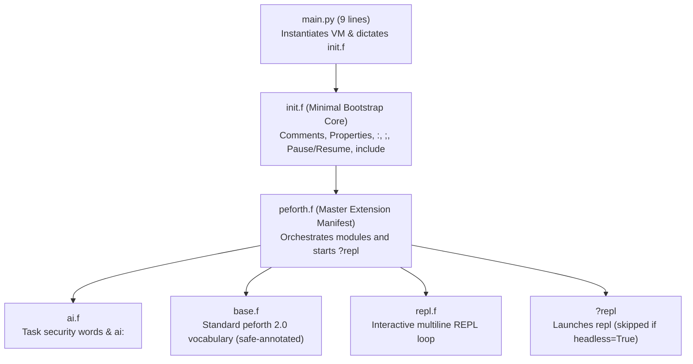
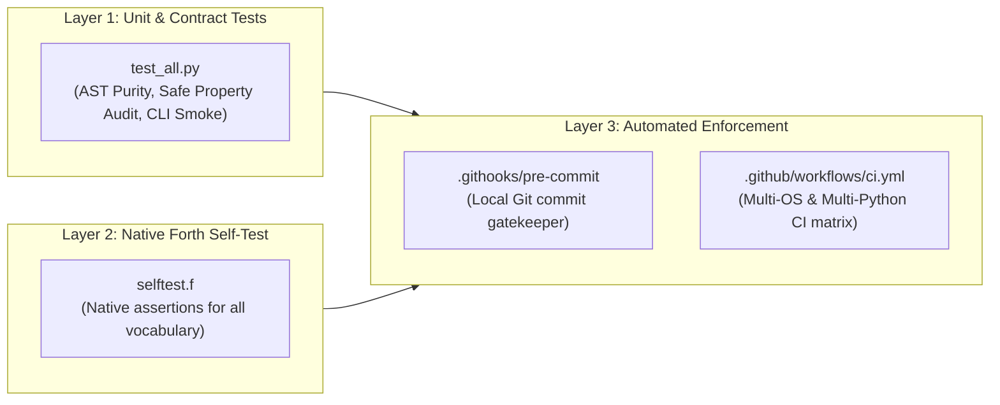

# peforth v2.1.0 Architecture Specification

- **Target Branch:** `develop-210`
- **Specification Status:** Active / Core Architecture Contract
- **Author:** peforth Development Team
- **Foundation:** Project K v2.1.0 Minimal Forth Kernel & Task Security Model

---

## 1. Executive Summary & Design Philosophy

`peforth v2.1.0` is a complete architectural reimagining of the `peforth` environment, shifting from a **Python-centric host supervisor** to a **Forth-driven host environment**.

### The Golden Rule
> **"Forth drives Forth; Python provides host primitives."**

### Architectural Contrast

| Dimension | peforth v2.0 (Legacy) | peforth v2.1.0 (Current) |
| :--- | :--- | :--- |
| **Control Flow** | Python monolithic supervisor (`repl.py`, 1290+ lines) manages loops, terminal UI, history, and calls Forth via `vm.dictate()`. | Minimal Python bootloader (`main.py`, 9 lines). Forth boots itself, configures modules, and controls the REPL loop in `repl.f`. |
| **Kernel Purity** | Kernel (`projectk.py`) mixed with legacy assumptions, older `ForthError`, and ad-hoc task mechanics. | Micro-kernel (`projectk.py`, ~450 lines) with zero external dependencies, strictly 2 seed words (`code` / `end-code`), uniform `KernelError`, and generator-based coroutine tasks. |
| **AI Integration** | Scattered across multiple Python modules (`ai_bridge.py`, `ai_tools.py`, `session_store.py`) and bloated `f/ai.f` (86 KB). | Clean decoupling: `ai.py` provides raw OpenAI-compatible SSE streaming & security guard; `ai.f` defines Forth words (`ai:`, `trust-task`, `cancel-task`). |
| **Security Model** | Implicit or ad-hoc runtime checks. | Formal task-level security approval: every vocabulary word carries a `safe=True` or `safe=False` property. Untrusted AI tasks pause upon hitting unsafe words. |
| **Regression Defense** | Ad-hoc pytest test files. | Triple-guard testing: Architectural AST contract tests, native Forth self-test (`selftest.f`), local Git pre-commit hook, and multi-OS/multi-Python CI matrix. |

---

## 2. Bootstrapping Chain

The initialization pipeline is strictly layered. No file may jump ahead or assume state from a downstream module.



### File Responsibilities

1. **`main.py`** (9 lines):
   - Sets up `__file__dir__` in `vm.host`.
   - Dictates `init.f`.
   - Never contains `while True:`, `input()`, or custom command dispatch.

2. **`init.f`**:
   - Minimal words required to bootstrap and load `ai.f`:
     - Documentation & Comments: `\`, `(`, `//`, `///`
     - Word property manipulation: `(last)`, `last`, `::`
     - Colon compiler: `:`, `;`, `immediate`
     - Stack/literal helpers: `true`, `false`, `rest`
     - Task control: `pause`, `resume`, `abort`, `(bye)`, `bye`
     - Reflection & Loading: `include`, `'`, `help`
   - **Final line**: strictly `include peforth.f`.

3. **`peforth.f`**:
   - System manifest that includes modules in order:
     ```forth
     include ai.f
     include base.f
     include repl.f
     ```
   - Conditional REPL launcher `?repl`:
     ```forth
     code ?repl
         if not vm.host.get("headless", False):
             yield from vm.call(vm.tick("repl"))
         end-code
     ?repl
     ```
   - Setting `vm.host["headless"] = True` allows automated tests and Python libraries to import peforth without blocking on terminal input.

4. **`ai.f` & `ai.py`**:
   - `ai.py`: Stateless HTTP SSE client using standard library `urllib`, tools definitions (`peforth_search_words`, `peforth_run_forth`), and the `security_aware_call` decorator.
   - `ai.f`: Defines `trust-task`, `cancel-task`, and `ai:`.

5. **`base.f`**:
   - Comprehensive Forth standard library inherited from peforth 2.0.0.
   - Every pure, side-effect-free word is explicitly annotated with `last :: safe=True`.
   - Control flow engine (`branch`, `0branch`, `doNext`, `here`, `,`, `!`, `@`) operates directly on `vm.frame.colon_code` and `vm._builder.colon_code`.

6. **`repl.f`**:
   - Interactive REPL implemented in Forth as a `code repl` word.
   - Features multiline input accumulation, state-aware continuation (`forth>` vs `... `), and optional `prompt_toolkit` keybindings with standard `input()` fallback.

---

## 3. Micro-Kernel Invariants (`projectk.py`)

The micro-kernel is the inviolable core of the system. The following invariants are strictly enforced:

1. **Zero External Dependencies**:
   - `projectk.py` may only import Python standard library modules: `dataclasses`, `inspect`, `io`, `re`, `tokenize`.
   - No UI frameworks, no networking libraries, and no terminal formatting packages.

2. **Minimal Seed State**:
   - On instantiation (`vm = VM()`), the dictionary contains **strictly two words**: `code` and `end-code`.
   - All other words (including `:`, `;`, `dup`, `drop`) are defined dynamically from Forth source files.

3. **Coroutine Task Model**:
   - Tasks are Python generator continuations.
   - `yield vm.pause()` cooperatively suspends a task and yields control back to the caller.
   - `task.resume()` continues execution from the exact suspension point.
   - `task.cancel()` closes the continuation and releases active task locks.

4. **Stack Isolation**:
   - Data stack (`vm.dstack`) is shared across task evaluations.
   - Return stack (`vm.rstack`) and temporary stack (`vm.tstack`) are **task-private** (`task.rstack`, `task.tstack`).

5. **Uniform Exceptions**:
   - All compilation, execution, and boundary failures raise `KernelError`.

---

## 4. Task-Level Security Specification

To support autonomous AI pair programming safely, peforth implements task-level security approval.

### The `safe=True` Property
Every word registered in the dictionary carries a metadata property `safe` (boolean):
- **Safe Words (`safe=True`)**:
  Pure operations without host side effects, disk I/O, or system destruction.
  - Stack words: `dup`, `drop`, `swap`, `over`, `rot`, `nip`, `pick`, `roll`, `slice`
  - Math & Logic: `+`, `-`, `*`, `/`, `mod`, `abs`, `negate`, `max`, `min`, `=`, `<`, `>`, `0=`, `and`, `or`, `XOR`, `<<`, `>>`
  - Control structures: `if`, `else`, `then`, `begin`, `while`, `repeat`, `for`, `next`, `case`, `of`, `endof`, `endcase`
  - Read-only reflection: `words`, `see`, `help`, `count`, `trim`, `type`
- **Unsafe Words (Default / `safe=False`)**:
  Operations that modify system state, execute arbitrary host code, or alter input buffers.
  - Python host code execution: `<py>`, `</py>`, `</pyV>`, `py:`, `py>`, `py::`, `py>>`
  - Input stream mutation: `tib.append`
  - Dictionary removal: `forget`
  - Arbitrary OS/Disk operations

### Security Guard Workflow

1. The security guard wraps `vm.call` during `ai.install_security_guard(vm)`.
2. **Human Exemption**: When a human interacts directly with the Forth REPL or runs scripts, `vm.host.get("in_ai_task")` is `None`. Human commands run unrestricted with full host privileges.
3. **AI Task Interception**:
   - When the AI assistant proposes Forth source via `peforth_run_forth`, the task is flagged in `vm.host["in_ai_task"]`.
   - Before executing any word, `security_aware_call` checks if `task in trusted_ai_tasks`.
   - If untrusted and the word is **not** `safe=True`, the task halts immediately via `yield vm.pause()`, outputting:
     ```text
     [Security] Word '<name>' is not marked as safe.
     Task paused for review. Type 'resume' for single step, 'trust-task resume' to trust this task.
     ```
4. **Human Review Actions**:
   - `resume`: Approves the single current step and resumes task execution.
   - `trust-task`: Adds the task to `trusted_ai_tasks`, whitelisting it for the remainder of its execution.
   - `cancel-task`: Calls `task.cancel()` to abort the untrusted task immediately.

---

## 5. Triple-Guard Testing Architecture

To permanently prevent conceptual drift, human regression, or architecture degradation, testing is enforced on three independent layers:



### Layer 1: Architectural Contract Tests (`test_all.py`)
- Zero external dependencies (runs via standard `python3 test_all.py` or `pytest`).
- **`TestKernelPurity`**:
  - Uses Python `ast` parser to guarantee no non-standard packages are imported in `projectk.py`.
  - Verifies `VM()` initially has strictly 2 words.
  - Verifies `projectk.py` never calls Python's builtin `input()`.
- **`TestArchitecturalContracts`**:
  - Enforces `main.py` is under 20 lines without loops or input prompts.
  - Enforces `init.f` ends with `include peforth.f`.
- **`TestSafePropertyAudit`**:
  - Iterates every standard word in `base.f` and asserts `word.properties["safe"] is True`.
  - Asserts unsafe words (`<py>`, `forget`, `tib.append`) are `safe=False`.
- **`TestSecurityTaskApproval`**:
  - Simulates an AI task hitting an unsafe word and asserts `task.status == "paused"`.
  - Asserts that `trust-task` permits resumption to `task.status == "done"`.

### Layer 2: Native Forth Self-Test (`selftest.f`)
- 100% Forth-idiomatic assertions covering stack manipulation, return/temp stacks, arithmetic, bitwise logic, string parsing, control structures (`if`, `for`, `while`, `case`), defining words (`constant`, `variable`, `value`), and Python interop (`py>`, `:>`).
- Executable via `include selftest.f` or interactive `selftest` word.

### Layer 3: Gatekeeper Automation
- **Local Pre-Commit Hook** (`.githooks/pre-commit`):
  - Configured in git via `git config core.hooksPath .githooks`.
  - Runs before every `git commit`. If any contract or assertion fails, the commit is rejected immediately.
- **CI Matrix Workflow** (`.github/workflows/ci.yml`):
  - Automatically runs on Push and PR across `ubuntu-latest`, `windows-latest`, and `macos-latest` on Python versions `3.10`, `3.11`, `3.12`, `3.13`, and `3.14`.

---

## 6. Guidelines for Porting Future Extensions

When porting legacy peforth modules (e.g. `auxiliary.f`, `herdr.f`, plugins) into `develop-210`:

1. **Place in the Module Manifest**:
   Add new modules to `peforth.f` before `include repl.f`.
2. **Explicit Safe Property Tagging**:
   Tag every side-effect-free word with `last :: safe=True`. If a word performs disk, network, or terminal manipulation, leave it untagged (`safe=False`).
3. **Synchronize Tests**:
   - Add native assertions for new words into `selftest.f`.
   - If new words are pure, append their names to `pure_words` in `test_all.py`.
4. **Never Shift Host Logic into Python**:
   Host communication should remain thin wrapper code. Presentation, interaction loops, and vocabulary orchestration must remain in Forth.
