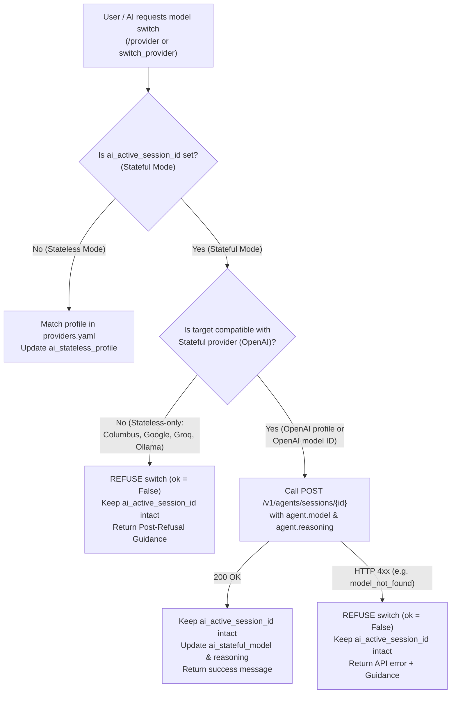

# Implementation Plan: Stateful vs. Stateless Model Switching & Refusal Guidance

## Goal Description

Based on live verification against the OpenAI Agents API (`POST /v1/agents/sessions/{session_id}`), model switching in **Stateful mode** (`vm.host["ai_active_session_id"]` is set) must distinguish between two cases:

1. **Switching to a Stateful-Compatible Model (Allowed in Stateful Mode)**:
   - Live verification confirmed that `POST /v1/agents/sessions/{session_id}` with `{"agent": {"model": "<model>", "reasoning": {"effort": "<effort>"}}}` returns `200 OK` and updates the active remote session's model and reasoning effort in-place (for example, switching between `gpt-6-luna` and `gpt-6.1-terra`, or changing reasoning effort between `none`, `low`, `medium`, `high`).
   - Previously, `apply_stateless_provider()` unconditionally executed `vm.host.pop("ai_active_session_id", None)` on line 1301 of `ai.py`, which dropped the user out of Stateful mode even when selecting an OpenAI model.
   - **Fix**: When in Stateful mode and the target model belongs to the Stateful provider (`OpenAI` / matching `stateful.endpoint`), keep `ai_active_session_id` intact and update the active remote session via `POST /v1/agents/sessions/{session_id}`. If the remote API rejects an unsupported model ID with HTTP 400/404, report the refusal without losing the Stateful session.

2. **Switching to a Stateless-Only Provider/Model (Refused with Post-Refusal Guidance)**:
   - When in Stateful mode and the user or AI attempts to switch to a **Stateless-only** provider/profile (e.g., `Columbus`, `Google`, `Groq`, `Ollama` -- any profile whose `provider` or `endpoint` does not match `stateful` in `providers.yaml`), the switch **must be refused** (`ok = False`) while keeping `ai_active_session_id` intact.
   - Because the action is rejected, the response is **not a warning**, but a **Refusal + Post-Refusal Guidance** explaining:
     1. Why it was refused (currently in Stateful mode on remote session `sess_...`, and the requested provider is Stateless-only).
     2. How to switch to another Stateful-compatible OpenAI model if desired.
     3. How to delegate a one-shot task to that Stateless model without leaving the Stateful session (`/with-model <spec> subagent: <prompt>`).
     4. How to exit Stateful mode first (`/ai-new`) if the user genuinely wants to switch the main conversation to Stateless mode.

3. **Companion Fixes from Terminal Testing (`w1:p2`)**:
   - **Mid-turn `switch_provider` in `_stateless_turn_loop()`**: Reload `get_active_stateless_profile(vm)` and update `p_name`, `base_url`, `model`, `reasoning_effort`, `api_key`, and `streamer.provider_info` when `switch_provider` succeeds (`ok = True`), so the follow-up completion in the same turn runs on and displays the newly switched model.
   - **`/ai-status` in `ai.f`**: Use `ai.get_active_provider_info(vm)` in Stateless mode instead of hardcoded `os.environ.get("OPENAI_MODEL", "gpt-6-luna")`.

---

## Decision Matrix for Provider / Model Switching



---

## Proposed Changes

### 1. AI Engine & Provider Management ([ai.py](file:///D:/GitHub/peforth/ai.py))

#### [MODIFY] [ai.py](file:///D:/GitHub/peforth/ai.py)
1. **Helper `_is_stateful_compatible_profile(vm, profile: dict) -> bool`**:
   - Compares `profile.get("provider")` and `profile.get("endpoint")` against `get_stateful_config(vm)` (`provider: "OpenAI"`, `endpoint: "https://api.openai.com/v1"`).
   - Returns `True` if both provider and normalized base endpoint match the `stateful` configuration, `False` otherwise (e.g., `Columbus`, `Google`, `Groq`, `Ollama`).
2. **Stateful Model Update Helper `_update_stateful_session_model(vm, session_id: str, model: str, reasoning: str = None) -> tuple[bool, str]`**:
   - Sends `POST /sessions/{encoded_id}` with `payload={"agent": agent_patch}` where `agent_patch` sets `"model": model` and (if `reasoning` is provided) `"reasoning": {"effort": reasoning.lower()}`.
   - Once `200 OK` is returned (or if queued during `requires_action`), updates `vm.host["ai_stateful_model"] = model` and `vm.host["ai_stateful_reasoning"] = reasoning.lower()`.
   - If the server returns `404 model_not_found` or `400 invalid_request_error`, keeps `ai_active_session_id` intact and returns `False` with the API's error message and guidance.
3. **Update `apply_stateless_provider(vm, spec: str, reasoning: str = None)`**:
   - Check if `active_session_id = vm.host.get("ai_active_session_id")` is active:
     - **If `active_session_id` is set and the matched profile is Stateless-only (`not _is_stateful_compatible_profile(vm, matched_profile)`)**:
       - **Do NOT pop `ai_active_session_id`**.
       - Return `(False, refusal_guidance_msg)`:
         ```text
         [Provider Refused] Cannot switch to Stateless provider '<Provider> | <Model>' while in Stateful mode (active remote session: <session_id>, provider: OpenAI | <current_model>).
         Guidance:
           1. To switch models within this Stateful session, choose an OpenAI Agents API compatible model (e.g. '/provider OpenAI gpt-6.1-terra').
           2. For a one-shot task using '<Provider> | <Model>' without leaving Stateful mode, use:
              /with-model <matched_key> subagent: <prompt>
           3. To exit Stateful mode and return to local Stateless mode first, run:
              /ai-new
              and then switch provider again.
         ```
     - **If `active_session_id` is set and the matched profile IS Stateful-compatible (or `spec` is an OpenAI model name without a non-OpenAI provider)**:
       - Call `_update_stateful_session_model(vm, active_session_id, target_model, target_reasoning)` while keeping `ai_active_session_id` intact.
4. **Update `get_active_provider_info(vm)` and `ai_turn_stateful()`**:
   - In `get_active_provider_info(vm)`, when `ai_active_session_id` is set, read `vm.host.get("ai_stateful_model") or st.get("model", "gpt-6-luna")` and `vm.host.get("ai_stateful_reasoning") or "none"`.
   - In `ai_turn_stateful()`, when `switch_provider` succeeds mid-turn, also update `streamer.provider_info` so subsequent output boxes in the same turn reflect the new OpenAI model/reasoning.
   - In `ai_turn()`, if `active_session_id` is set and `pending_opts.get("model")` specifies a **Stateless-only** provider for a mainstream `ai:` turn, refuse with guidance to use `with-model <spec> subagent: <prompt>` instead of silently splitting history into local `ai_messages`.
5. **Refresh active profile mid-turn in `_stateless_turn_loop()`**:
   - In `_stateless_turn_loop()`, when `fn_name == "switch_provider"` returns `ok = True` (and `not is_subagent`), re-read `prof = get_active_stateless_profile(vm)` and update `p_name`, `base_url`, `model`, `reasoning_effort`, `api_key`, and `streamer.provider_info`.

---

### 2. Forth AI Vocabulary ([ai.f](file:///D:/GitHub/peforth/ai.f))

#### [MODIFY] [ai.f](file:///D:/GitHub/peforth/ai.f)
1. **`ai-status` ([ai.f](file:///D:/GitHub/peforth/ai.f#L659))**:
   - In Stateless mode, use `ai.get_active_provider_info(vm)` instead of `os.environ.get("OPENAI_MODEL", "gpt-6-luna")` so `/ai-status` accurately shows `<Provider> | <Model> (Reasoning: <effort>)`.
2. **`ai-use` & `ai-new` ([ai.f](file:///D:/GitHub/peforth/ai.f#L600-L618))**:
   - In `ai-use`, capture the remote session's `agent.model` and `agent.reasoning.effort` into `vm.host["ai_stateful_model"]` and `vm.host["ai_stateful_reasoning"]`.
   - In `ai-new`, clear `vm.host.pop("ai_stateful_model", None)` and `vm.host.pop("ai_stateful_reasoning", None)`.

---

### 3. Unit Tests ([test_all.py](file:///D:/GitHub/peforth/test_all.py))

#### [MODIFY] [test_all.py](file:///D:/GitHub/peforth/test_all.py)
- Add unit tests covering:
  1. **Stateful -> Stateless-only provider refused**: Calling `apply_stateless_provider(vm, "Columbus GPT-6 Luna")` or `"Google"` when `ai_active_session_id` is set returns `ok = False` with post-refusal guidance (`subagent:`, `/ai-new`, and OpenAI model option) and preserves `ai_active_session_id`.
  2. **Stateful -> Stateful-compatible OpenAI model allowed**: Calling `apply_stateless_provider(vm, "gpt-6.1-terra", reasoning="high")` when `ai_active_session_id` is set sends `POST /sessions/{id}` with `agent.model = "gpt-6.1-terra"`, keeps `ai_active_session_id` intact, and updates `get_active_provider_info(vm)`.
  3. **Stateful -> Unsupported OpenAI model rejected by remote API**: If `POST /sessions/{id}` returns HTTP 404 `model_not_found`, `apply_stateless_provider` returns `ok = False` and preserves `ai_active_session_id`.
  4. **Mid-turn `switch_provider` in Stateless mode**: Updates the model and `streamer.provider_info` for the follow-up completion in the same turn.
  5. **`/ai-status` in Stateless mode**: Displays the active Stateless provider and model from `get_active_provider_info(vm)`.

---

## Verification Plan

### Automated Tests
```powershell
Set-Location D:\GitHub\peforth; python test_all.py
Set-Location D:\GitHub\ChatLKK_CLI; python test_all.py
```

### Sync & Manual Verification
- Sync updated `ai.py`, `ai.f`, and `test_all.py` across `D:\GitHub\peforth`, `D:\GitHub\ChatLKK_CLI`, and `D:\Downloads\ChatLKK_CLI_portable\chatlkk`.
