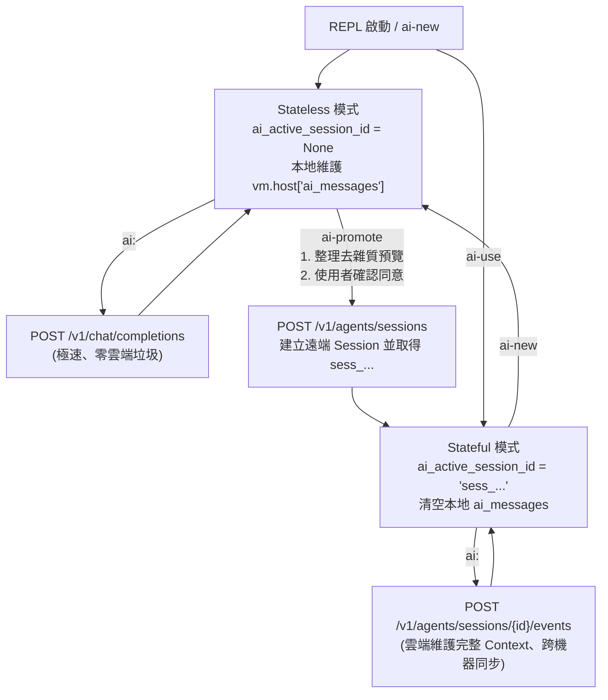

# 雙模混合架構（Stateless + Stateful）與 `ai-promote` 實作計畫

## 目標說明

根據 [`peforth-architecture-qa-notes-20261106.md`](file:///c:/Users/hcche/OneDrive/Documents/GitHub/peforth/docs/development/peforth-architecture-qa-notes-20261106.md)（Q6、Q10、Q12、Q13）的設計結論，將 `peforth v2.1.0` 的 AI 子系統升級為**雙模混合架構（Dual-Mode Hybrid Architecture）**，並實作 **`ai-promote`** 指令：

1. **預設 Stateless 模式（無 `ai_active_session_id`）**：
   - 啟動後預設（或執行 `ai-new` 後）使用輕量、快速的 `POST /chat/completions` 端點，上下文維護於本地記憶體 `vm.host["ai_messages"]`。
2. **Stateful 模式（有 `ai_active_session_id`）**：
   - 當透過 `ai-use` 選取既有遠端 Session、或透過 `ai-promote` 晉升為遠端 Session 後，`ai:` / `(ai)` 自動切換為呼叫 **OpenAI Agents API (`/v1/agents/sessions/{id}/events`)**。
   - 解決先前 `ai-use` 只在本地撈 50 則訊息卻不寫回雲端所造成的「腦裂（Split-Brain）」問題。
3. **`ai-promote`（本地對話晉升雲端 Session）**：
   - 將目前 `vm.host["ai_messages"]` 的本地對話進行**去雜質整理**（濾除 System Prompt、字典查詢 JSON 傾印、失敗的程式碼嘗試、審核選單 ANSI 雜訊、Base64 巨型圖片字串）。
   - 將整理後的乾淨前後文預覽印給使用者過目，詢問是否同意。
   - 獲得同意後，作為初始 Context 發送至 `POST /v1/agents/sessions` 建立新的遠端 Session，取得 `sess_...` ID 後綁定至 `vm.host["ai_active_session_id"]` 並清空 `ai_messages`，無縫進入 Stateful 模式。

---

## 架構流程圖



---

## 需要您確認的設計細節

> [!IMPORTANT]
> **關於 `ai-promote` 的「簡單整理、去掉雜質」規則**
> 我們規劃採用**確定性規則清理（Rule-based Distillation，零延遲、不竄改原意）**，從 `vm.host["ai_messages"]` 提煉出乾淨對話：
> 1. **System Prompt 走專屬欄位上傳（不混在對話預覽裡重複貼兩次）**：
>    - 我們辛苦調校的 `get_system_prompt(vm)`（含核心規則與所有 Skills）在建立遠端 Session 時，會**完整放進 Agents API 的專屬欄位 `payload["agent"]["instructions"]` 送給遠端**！
>    - 至於 `vm.host["ai_messages"][0]` 裡那份相同的 `role: "system"` 就不必再重複塞進 `payload["input"]`（使用者對話紀錄）裡，這樣一來既不會把 20KB 的 System Prompt 重複送兩次，二來在螢幕上預覽詢問您是否同意時，您看到的也只會是乾淨的「使用者 ↔ AI 對話內容」，不會被幾百行的 System Prompt 洗版。
> 2. **移除查詢類與失敗的 Tool Calls**：
>    - 濾除 `peforth_search_words`、`peforth_search_sessions` 的龐大 JSON 回傳結果。
>    - 濾除執行失敗（`error` 非空）的 `peforth_run_forth` 嘗試紀錄。
>    - 對於執行成功的 `peforth_run_forth`，僅保留精簡的 `[Executed Forth (<purpose>)]: <source>` 與乾淨輸出（自動剝除 `1. Allow Once...` 等安全審核 ANSI 選單雜訊）。
> 3. **移除 Base64 圖片巨型字串**：若 `user` 訊息含截圖，替換為 `[Image attached]` 標記。
> 4. **結尾附上簡短交接提示**：請遠端 Agent 簡短確認已收到前情提要，完成新 Session 初始化。

---

## 預計修改檔案與內容

### 1. AI 傳輸與雙模引擎 (`ai.py`)

#### [MODIFY] [ai.py](file:///C:/Users/hcche/OneDrive/Documents/GitHub/peforth/ai.py)

1. **新增本地對話去雜質整理函式 `distill_messages_for_promotion(messages)`**：
   - 輸入 `vm.host["ai_messages"]`，依上述規則過濾雜質，回傳 `(distilled_text, stats_dict)`（包含保留的對話輪數、過濾掉的雜訊筆數、整理前後字元數對比）。
2. **新增 OpenAI Agents API Stateful 執行支援**：
   - `AGENTS_TOOLS_DEFINITION`：對應 Agents API 格式（`{"type": "function", "name": ...}`）的工具定義（`peforth_search_words`、`peforth_search_sessions`、`peforth_run_forth`）。
   - `_agents_event_stream(response)` 與 `_submit_agents_tool_result(session_id, turn_id, call_id, success, output)`：處理 `/v1/agents/sessions` 的 SSE 事件流（`agent.session.turn.output_text.delta`、`agent.session.requires_action`、`agent.session.turn.completed`）與工具結果回傳。
   - `ai_turn_stateful(vm, prompt, stream_response, session_id=None, create_new=False)`：
     - 當 `create_new=True`（由 `ai-promote` 呼叫）時，發送 `POST /sessions` 建立遠端 Session，從事件流捕獲 `sess_...` 並寫入 `vm.host["ai_active_session_id"]`。
     - 當 `session_id` 已存在（`ai-use` 或 `ai-promote` 之後的 `ai:`）時，發送 `POST /sessions/{id}/events` 推進遠端對話。
     - 當遠端要求執行 `peforth_run_forth` 時，直接復用 v2.1.0 的 `yield from vm.evaluate(source)` 與 `security_aware_call` 安全審核機制，審核拒絕或執行結果皆透過 `agent.session.input.tool_result` 送回雲端。
3. **更新 `ai_turn(vm, prompt, stream_response)` 雙模路由**：
   - 若 `not isolated_session and vm.host.get("ai_active_session_id")`：委派給 `ai_turn_stateful(...)`。
   - 否則：維持現有的 Stateless `/chat/completions` 流程。
4. **新增 `promote_local_session(vm)` 生成器**：
   - 檢查 `vm.host.get("ai_messages")` 是否有有效對話。
   - 呼叫 `distill_messages_for_promotion(messages)` 產生乾淨的前情提要。
   - 在終端機印出整理統計與完整預覽內容，並透過 `read_numbered_choice` 詢問使用者：
     - `1. Promote to new remote session`
     - `2. Cancel`
   - 若使用者選 `1`，呼叫 `yield from ai_turn_stateful(vm, promoted_prompt, stream_response=True, create_new=True)`，成功取得 `ai_active_session_id` 後清除 `vm.host["ai_messages"]`。

---

### 2. Forth AI 詞彙層 (`ai.f`)

#### [MODIFY] [ai.f](file:///C:/Users/hcche/OneDrive/Documents/GitHub/peforth/ai.f)

1. **新增 `code ai-promote`**：
   ```forth
   code ai-promote
       import ai
       yield from ai.promote_local_session(vm)
       end-code
       // ( -- ) Distill current local conversation, ask for confirmation, and promote to a new remote Agents API session.
       last :: safe=False
   ```
   （標記為 `safe=False`，確保只有使用者主動下達或經審核才能建立遠端 Session。）
2. **修正 `code ai-use`**：
   - 移除今天凌晨加入的「從本地 SQLite 撈 50 則訊息塞入 `ai_messages`」邏輯，改為設定 `vm.host["ai_active_session_id"] = row["id"]` 並清空 `vm.host.pop("ai_messages", None)`，因為後續對話將直接由遠端 Stateful Session 接管。
3. **微調 `code ai-new` 與 `code ai-status`**：
   - `ai-new`：清除 `ai_active_session_id` 與 `ai_messages`，印出明確提示已回到預設 Stateless（本地 `/chat/completions`）模式。
   - `ai-status`：當有 `ai_active_session_id` 時明確標示為 `Stateful (remote Agents API session)`；當無 `ai_active_session_id` 但有 `ai_messages` 時標示為 `Stateless (local in-memory, use ai-promote to save remotely)`。

---

### 3. 文件更新 (`skills/peforth-forth/`)

#### [MODIFY] [SKILL.md](file:///C:/Users/hcche/OneDrive/Documents/GitHub/peforth/skills/peforth-forth/SKILL.md) & [forth-reference.md](file:///C:/Users/hcche/OneDrive/Documents/GitHub/peforth/skills/peforth-forth/references/forth-reference.md)
- 補充說明雙模架構（預設 Stateless、透過 `ai-use` 或 `ai-promote` 切換為 Stateful）與 `ai-promote` 的用途。

---

## 驗證計畫

### 自動化測試 (`test_all.py`)
執行指令：
```powershell
C:\Users\hcche\venvs\misc\Scripts\python.exe -m unittest test_all.py
```
新增測試案例：
1. `test_distill_messages_for_promotion`：驗證 `system` prompt、`peforth_search_words` 傾印、失敗的 `peforth_run_forth`、ANSI 審核字串、以及 Base64 圖片是否都被乾淨濾除，且保留所有有效對話與成功執行的程式碼摘要。
2. `test_ai_promote_confirmation_and_state_transition`：
   - 模擬使用者在選單選 `2 (Cancel)`：確認不會發送網路請求，`ai_messages` 原封不動保留。
   - 模擬使用者在選單選 `1 (Promote)`：確認發送 `POST /sessions`、取得新 `sess_...`、寫入 `vm.host["ai_active_session_id"]` 並清空 `vm.host["ai_messages"]`。
3. `test_dual_mode_routing_stateless_vs_stateful`：
   - 驗證無 `ai_active_session_id` 時，`ai:` 呼叫 `/chat/completions`。
   - 驗證有 `ai_active_session_id`（經 `ai-use` 或 `ai-promote`）時，`ai:` 呼叫 `/agents/sessions/{id}/events`，且 `ai-new` 後切回 `/chat/completions`。
