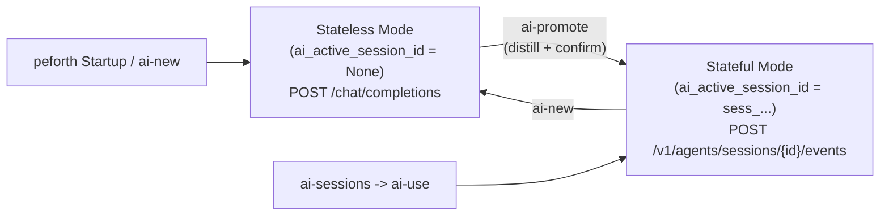

# Walkthrough: Dual-Mode Hybrid AI Architecture & `ai-promote`

## Summary of Changes

We have implemented the **Dual-Mode Hybrid AI Architecture** and the **`ai-promote`** word on the `develop-210` branch (commit `9d50610`), combining the zero-pollution agility of local Stateless `/chat/completions` with the cross-machine cloud persistence of the OpenAI Agents API (`/v1/agents/sessions`).

### 1. Context Distillation & `ai-promote` ([ai.py](file:///C:/Users/hcche/OneDrive/Documents/GitHub/peforth/ai.py), [ai.f](file:///C:/Users/hcche/OneDrive/Documents/GitHub/peforth/ai.f))
- **[`distill_messages_for_promotion()`](file:///C:/Users/hcche/OneDrive/Documents/GitHub/peforth/ai.py#L1538-L1651)**:
  - Strips `peforth_search_words` and `peforth_search_sessions` lookup dumps.
  - Drops failed or denied `peforth_run_forth` tool calls while preserving successful Forth executions (`[Executed Forth (purpose)]: ... Output: ...`).
  - Strips ANSI escape codes and interactive security approval menu noise via [`_clean_tool_stdout()`](file:///C:/Users/hcche/OneDrive/Documents/GitHub/peforth/ai.py#L1529-L1535).
  - Replaces heavy Base64 image payloads with `[Image attached]`.
  - Keeps our full [`get_system_prompt(vm)`](file:///C:/Users/hcche/OneDrive/Documents/GitHub/peforth/ai.py#L1401-L1506) out of `payload["input"]` and sends it in full via `payload["agent"]["instructions"]` when creating the remote session.
- **[`promote_local_session(vm)`](file:///C:/Users/hcche/OneDrive/Documents/GitHub/peforth/ai.py#L2015-L2064) & Forth word [`ai-promote`](file:///C:/Users/hcche/OneDrive/Documents/GitHub/peforth/ai.f#L561-L567)**:
  - Displays a summary of turns, removed noise items, character reduction, and a preview of the distilled transcript.
  - Prompts the user (`1. Promote to new remote Agents API session` / `2. Cancel`).
  - On confirmation, calls `POST /v1/agents/sessions` to create a remote session, binds `vm.host["ai_active_session_id"]`, and clears `vm.host["ai_messages"]`.

### 2. Dual-Mode Routing & Split-Brain Fix ([ai.py](file:///C:/Users/hcche/OneDrive/Documents/GitHub/peforth/ai.py), [ai.f](file:///C:/Users/hcche/OneDrive/Documents/GitHub/peforth/ai.f))
- **[`ai_turn()`](file:///C:/Users/hcche/OneDrive/Documents/GitHub/peforth/ai.py#L2067-L2086)** checks `vm.host.get("ai_active_session_id")`:
  - **`None` (Default Stateless Mode)**: Calls `POST /chat/completions` and stores turns locally in `vm.host["ai_messages"]`.
  - **`sess_...` (Stateful Mode)**: Routes turns to [`ai_turn_stateful()`](file:///C:/Users/hcche/OneDrive/Documents/GitHub/peforth/ai.py#L1767-L2012) (`/v1/agents/sessions/{id}/events`), handling SSE streaming and `session.action.required` tool calls (`peforth_search_words`, `peforth_search_sessions`, `peforth_run_forth`).
- **[`ai-use`](file:///C:/Users/hcche/OneDrive/Documents/GitHub/peforth/ai.f#L514-L552)**: Removed the 50-message SQLite preload into `ai_messages` so resuming a remote session routes directly to the Stateful Agents API without split-brain or message truncation.
- **[`ai-status`](file:///C:/Users/hcche/OneDrive/Documents/GitHub/peforth/ai.f#L575-L618)**: Clearly reports whether the VM is in `Mode: Stateless (/chat/completions; use 'ai-promote' to promote to a remote session)` (including its `[local_<16-hex>]` session ID) or `Mode: Stateful (remote Agents API session)`.

### 3. Local Session ID Tracking in `ai-diagnostics.sqlite3` ([ai.py](file:///C:/Users/hcche/OneDrive/Documents/GitHub/peforth/ai.py), [ai.f](file:///C:/Users/hcche/OneDrive/Documents/GitHub/peforth/ai.f))
- **[`_ensure_local_session_id(vm)`](file:///C:/Users/hcche/OneDrive/Documents/GitHub/peforth/ai.py#L647-L653)** & **[`_current_diagnostic_session_id(vm)`](file:///C:/Users/hcche/OneDrive/Documents/GitHub/peforth/ai.py#L656-L658)**:
  - Assigns a unique `local_<16-hex>` ID (`vm.host["ai_local_session_id"]`) to each local `ai_messages` conversation lifecycle.
  - Records `local_<16-hex>` in `turns.remote_session_id` and `timeline.session_id` in `ai-diagnostics.sqlite3` so multiple local conversations separated by `ai-new` within the same `runtime_id` can be cleanly distinguished and dumped.
  - Logs `ai_session_reset` on `ai-new` and `ai_session_promoted` (`from_local_session_id` -> `to_remote_session_id`) on `ai-promote`.

## Verification Results

- **Unit & Self-Test Suite** ([test_all.py](file:///C:/Users/hcche/OneDrive/Documents/GitHub/peforth/test_all.py), [test_session_store.py](file:///C:/Users/hcche/OneDrive/Documents/GitHub/peforth/test_session_store.py)):
  - Added [`test_distill_messages_for_promotion`](file:///C:/Users/hcche/OneDrive/Documents/GitHub/peforth/test_all.py#L1591-L1664) and [`test_ai_promote_and_dual_mode_routing`](file:///C:/Users/hcche/OneDrive/Documents/GitHub/peforth/test_all.py#L1666-L1725).
  - All **77 tests pass** (`0 failures, 0 errors`).
- **Runtime Sync**: Synced updated [`ai.py`](file:///C:/Users/hcche/OneDrive/Documents/GitHub/peforth/ai.py), [`ai.f`](file:///C:/Users/hcche/OneDrive/Documents/GitHub/peforth/ai.f), and [`forth-reference.md`](file:///C:/Users/hcche/OneDrive/Documents/GitHub/peforth/skills/peforth-forth/references/forth-reference.md) to `C:\Users\hcche\.peforth`.
