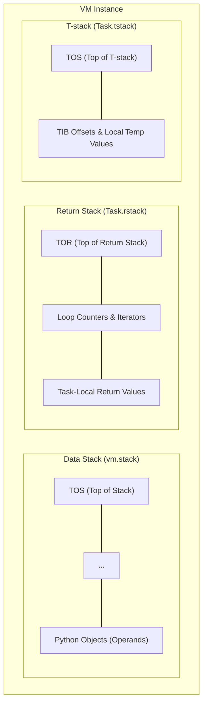
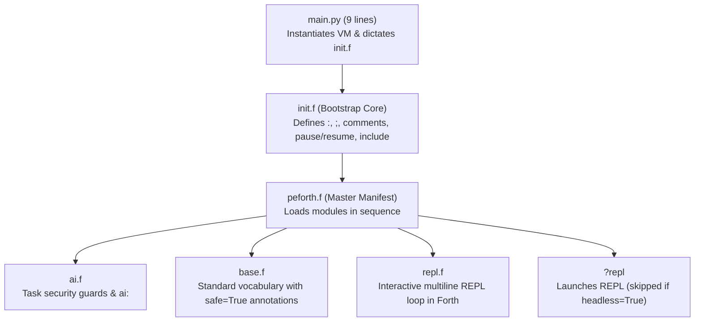
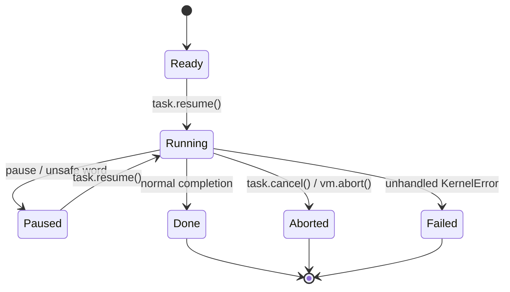

# peforth v2.1.0 — Forth Kernel Technical Manual and Architectural Philosophy

> English edition · Companion to the Traditional Chinese [peforth manual](peforth%20manual.md).
>
> Runtime: Python 3.10+ on Linux, WSL, and Windows.
> Principal sources: `main.py`, `init.f`, `peforth.f`, `projectk.py`, `repl.f`, `base.f`, `ai.f`, and `ai.py`.

This is an **architecture and design manual**, not an exhaustive dictionary word reference. Every Forth word provides runtime help and comments via `help` and `see`. For installation, virtual environment setup, configuration (`.env` and `providers.yaml`), the `f` CLI command, and quick start instructions, please consult the repository [README](../../README.md). For details on the AI assistant, also see [AI User Manual](ai.md).

---

## Preface — Minimalism, Revisited

Forth's enduring appeal lies in its small stack machine, postfix notation, open compiler, and the ability to extend the language from within itself. Re-creating a vintage flat-memory computer inside a modern operating system, however, can isolate Forth from the very facilities that make contemporary software productive.

**peforth (Python Edition)** takes another path: retain Forth's programmable language machinery while letting Python supply objects, libraries, I/O, and system integration. Rather than making Python look like Forth or turning Forth into a conventional Python wrapper, the two languages cooperate. Forth orchestrates; Python provides rich capabilities.

In `peforth v2.1.0`, this philosophy reaches its definitive expression:

> **"Forth drives Forth; Python provides host primitives."**

Instead of a monolithic Python supervisor controlling the outer loop, peforth 2.1.0 boots from a tiny 9-line shim (`main.py`), initializes its micro-kernel (`projectk.py`), constructs its compiler through `init.f`, loads its modules via `peforth.f`, and drives its interactive REPL directly inside Forth (`repl.f`).

---

## 1. Design Philosophy and Architecture

### 1.1 From Isolated Memory to a Symbiotic Microkernel

Traditional Forth implementations (FIG-Forth, Forth-79/83, ANS Forth) assume a linear address space (often a 64KB byte array) where cells store raw integers or memory addresses. On bare metal, this is elegant; in a modern OS with garbage collection, virtual memory, and rich object graphs, emulating a flat byte sandbox creates an artificial wall between Forth and the host environment.

In peforth, the data stack holds **Python object references** directly:
- Integers, floats, strings, lists, dictionaries, generators, coroutines, and custom class instances reside natively on the stack.
- Mechanism belongs to Forth; capability belongs to Python. Forth provides the control flow, domain-specific languages (DSLs), and metaprogramming factories; Python supplies heavy computations, system APIs, Unicode handling, and ecosystem libraries.

### 1.2 The Three Stacks

peforth divides computation and task-local state across three distinct stacks:



1. **Data Stack (`vm.stack`)**:
   - The shared operand highway across executions within the same VM instance.
   - Implemented as a native Python list. Popping from an empty stack triggers a clean `KernelError("Data stack underflow")`, preventing memory corruption.
2. **Return Stack (`Task.rstack`)**:
   - **Task-Private**: Each Task maintains its own return stack. `vm.rstack` dynamically proxies operations to the currently active Task.
   - Holds loop counters (for `for ... next / aft`) and temporary values (`>r`, `r>`, `r@`, `rdrop`). When a Task pauses, its loop state remains isolated and safe from interference by other tasks.
3. **T-stack (`Task.tstack`)**:
   - **Task-Private**: An auxiliary stack dedicated to scratch data, TIB cursor offsets, and internal parser checkpoints. Manipulated via `>t`, `t@`, and `t>`.

#### Stack Effect Notation
peforth adheres to standard stack effect conventions, with the Top of Stack (TOS) on the right:
```forth
( a b -- c )             \ Data stack only
( x -- ) ( R: -- x )     \ Crosses Data stack to Return stack
( x -- ) ( T: -- x )     \ Crosses Data stack to T-stack
```

### 1.3 Micro-Kernel Invariants (`projectk.py`)

The kernel (`projectk.py`, ~450 lines) is strictly protected by architectural invariants:
- **Zero External Dependencies**: Imports only Python standard library modules (`dataclasses`, `inspect`, `io`, `re`, `tokenize`).
- **Minimal Seed Primitives**: Boots with strictly **two seed words** defined in Python: `code` and `end-code`. All other words—including `:`, `;`, `if`, `else`, `then`, and `immediate`—are compiled into the dictionary by `init.f`.
- **Uniform Error Handling**: All kernel exceptions inherit from `KernelError`.

---

## 2. Bootstrapping Chain & Control Flow

In peforth 2.1.0, execution flows strictly from minimal bootstrapping to Forth-driven orchestration:



1. **`main.py`**:
   Sets up `__file__dir__` in `vm.host` and executes `init.f`. It contains no interactive loops or custom CLI parsing shims.
2. **`init.f`**:
   Constructs the essential compiler primitives (`:`, `;`, `immediate`), comment syntax (`\`, `(`, `//`, `///`), property modifiers (`last`, `::`), file loading (`include`), and task control (`pause`, `resume`, `abort`). Its final line executes:
   ```forth
   include peforth.f
   ```
3. **`peforth.f`**:
   The master manifest that includes `ai.f`, `base.f`, and `repl.f`, culminating in the conditional invocation word `?repl`. Setting `vm.host["headless"] = True` enables headless execution for automated testing without hanging on terminal input.
4. **`repl.f`**:
   The interactive REPL is implemented as a Forth word (`code repl`). It supports multiline input accumulation, state-aware continuation (`chat>` vs `>` vs `... `), and optional `prompt_toolkit` bindings with graceful fallback to standard `input()`.

---

## 3. Memory, Streams, and the PAD Concept

Traditional Forth relies on linear RAM buffers and a scratch region called `PAD`. In peforth:
- **No Emulated Flat RAM**: Text and binary data reside in native Python `str`, `bytes`, or stream buffers.
- **Task-Local TIB (Terminal Input Buffer)**: Each Task maintains its own input buffer and cursor. Forth words like `word`, `parse`, and `char` extract tokens directly from the active input stream.
- **Compile-Time Addressing**: Forth colon definitions are compiled into lists of executable steps in `vm.frame.colon_code`. Control flow branches (`branch`, `0branch`, `doNext`) store integer offsets pointing directly to target step indices in the code list.

---

## 4. Control Structures

Forth control structures are not hardcoded compiler syntax; they are immediate words that compile forward and backward branch offsets:

```forth
\ Conditional branching
condition if true-branch else false-branch then

\ Indefinite loops
begin condition while body repeat
begin body condition until
begin body again

\ Counted loops with optional initial skip
10 for r@ . next cr
10 for aft r@ . then next cr
```

`if`, `else`, `then`, `begin`, `while`, and `repeat` compile branch words and calculate target address offsets during compilation, demonstrating the simplicity of Forth's open compiler model.

---

## 5. Defining Words & Metaprogramming

Defining words act as factories that create new vocabulary words.

### 5.1 Standard Factories
- **`constant`**: `100 constant MAX_USERS` (pushes literal value upon execution).
- **`variable`**: `variable counter` (allocates a single-cell container `[None]`).
- **`value` / `to`**: `0 value speed` -> `speed .` -> `100 to speed`.

### 5.2 Custom Defining Words (`create ... does>`)
`create` builds the dictionary header for a new child word; `does>` attaches runtime Forth behavior executed whenever the child word is called:

```forth
: array ( size -- )
    create ( alloc ) py: [0]*pop() ,
    does> ( index -- addr ) @ swap py: pop(1)[pop()] ;
```

---

## 6. Python Interoperability

peforth provides bidirectional, frictionless interoperability with Python:

### 6.1 Inline Python (`py:`, `py>`)
- **`py: <code-statement>`**: Executes Python statements. Stack items can be manipulated via `pop()` and `push()`.
- **`py> <expression>`**: Evaluates a Python expression and pushes the result onto the Data Stack.
  ```forth
  py> os.path.exists("README.md") [if] .( File found! ) [then]
  ```

### 6.2 Host Property & Attribute Navigation (`::`, `:>`)
- **`:: <attr>=<value>`**: Sets a property on a dictionary word or object.
- **`:> <attr/method>`**: Accesses an object's attribute or calls a method:
  ```forth
  s" hello world" :> upper() . cr  \ Outputs: HELLO WORLD
  ```

### 6.3 Code Definitions (`code ... end-code`)
Define words whose implementation is pure Python:
```forth
code square ( n -- n^2 )
    n = vm.pop()
    vm.push(n * n)
end-code
```

---

## 7. Tasks, Cooperative Pause, and Coroutines

peforth v2.1.0 manages execution through cooperative Tasks built on Python generators.

### 7.1 Task Lifecycle & State Transitions



- **`ready`**: Task instantiated and waiting to start.
- **`running`**: Task currently actively executing steps.
- **`paused`**: Task cooperatively yielded control via `pause` or hit an untrusted security checkpoint. Its execution context, return stack, and continuation are frozen and preserved.
- **`done`**: Execution ran to normal completion.
- **`aborted` / `failed`**: Execution cancelled or terminated due to an uncaught error.

### 7.2 Why Generator Coroutines Matter
Because execution state is modeled as generator coroutines (`yield from vm.call(...)`), a Task can pause deep within a colon definition or nested loop. When `resume()` is called, execution continues precisely from the pause point without unwinding the stack or losing local loop indexes.

---

## 8. Task Security Model & Vocabulary Annotations

peforth 2.1.0 replaces ad-hoc security checks with a fine-grained, word-level security contract.

### 8.1 Word Annotations (`safe=True`)
Every word in `base.f` and standard packages is explicitly annotated:
```forth
code + ( a b -- a+b )
    b = vm.pop(); a = vm.pop()
    vm.push(a + b)
end-code
last :: safe=True
```
- Words without `safe=True` (e.g., words executing arbitrary Python code, spawning subprocesses, or altering the filesystem) are deemed potentially unsafe.

### 8.2 Security Approval Flow for AI Tasks
When an AI assistant executes generated Forth code via `peforth_run_forth`:
1. The code runs inside an untrusted Task.
2. As long as only `safe=True` words are executed, the Task proceeds at full speed.
3. The moment an unsafe word is executed, the VM invokes `pause`, yielding control to the outer REPL.
4. The REPL presents the user with an interactive security prompt:
   - `[a]llow once`: Approve this invocation only.
   - `[t]rust task`: Grant trust to this AI Task for its remaining duration.
   - `[d]eny`: Reject the word and raise an execution failure.
   - `[c]ancel`: Abort the entire AI task immediately.

---

## 9. Introspection, Decompilation, and Self-Documentation

### 9.1 Three-Stage Decompiler (`see`)
Typing `see <word>` activates the three-stage decompiler:
1. **Documentation Header**: Displays stack effect comments and `//`, `///` docstrings.
2. **Metadata Dictionary**: Dumps the word's Python properties (`type`, `immediate`, `safe`, `action`).
3. **Source Reconstruction**: Reconstructs the human-readable source definition based on the word type (colon definition, code block, constant, value, or variable).

### 9.2 Dictionary Exploration
- **`words [filter]`**: Lists all dictionary words matching an optional substring filter.
- **`help <pattern>`**: Performs a fuzzy search across word names, stack effects, and descriptions.

---

## 10. Engineering Architecture, Deployment, and Verification

### 10.1 Repository vs. Runtime Architecture

peforth maintains a strict separation between the development repository and runtime directories:
- **Repository (`.../peforth`)**: Contains source code, documentation, Git hooks, and the complete test suite.
- **Runtime (`~/.peforth` or `$HOME\.peforth`)**: A separate standalone clone with its own virtual environment (`.venv`), `.env` credentials, and `providers.yaml`.

### 10.2 Entry Point
The package entry point is defined in `pyproject.toml`:
```toml
[project.scripts]
f = "main:main"
```
Installing in editable mode (`uv pip install -e .`) exposes the `f` executable directly in your environment.

### 10.3 Triple-Guard Verification Suite
To prevent regressions, peforth 2.1.0 incorporates three layers of automated verification:
1. **Architectural AST Contract Tests**: Enforce architectural rules (e.g., `main.py` is under 15 lines and contains no loops; `init.f` ends strictly with `include peforth.f`).
2. **Native Forth Self-Test (`selftest.f`)**: A self-contained Forth test suite executed directly in the VM.
3. **Comprehensive Unit Suite (`test_all.py`)**: Tests data stacks, loops, control structures, tokenizers, multiline parsing, session storage, and security guards. Run tests via:
   ```bash
   python -m unittest test_all.py
   ```

---

## Conclusion — An Elegant Synthesis

peforth 2.1.0 demonstrates that minimalism and modern capabilities are not mutually exclusive. By establishing the golden rule—**"Forth drives Forth; Python provides host primitives"**—peforth achieves an extraordinarily lightweight micro-kernel, a flexible multi-provider AI pair programmer, and a secure, introspectable computing environment.
