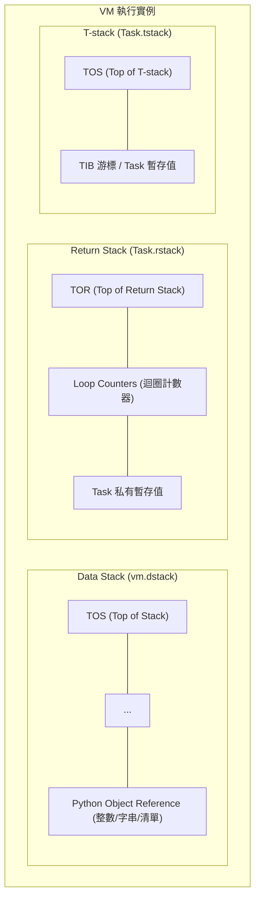
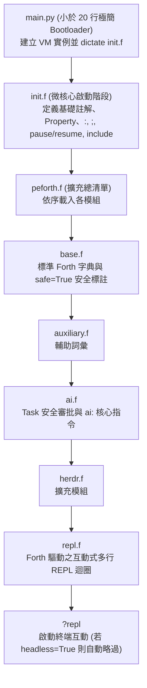
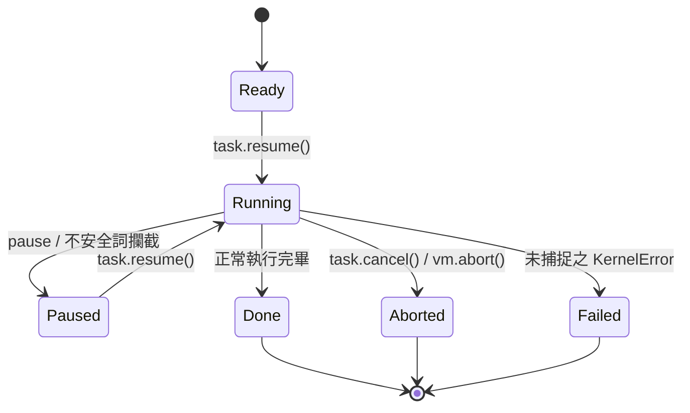

# peforth 2.1.0 共用 Forth Kernel 技術手冊與架構設計理念

> **版本**：peforth 2.1.0 核心技術架構規範手冊
> **適用環境**：Python 3.10+ / Linux, WSL, Windows
> **核心源碼**：`main.py`, `init.f`, `peforth.f`, `projectk.py`, `base.f`, `auxiliary.f`, `ai.f`, `herdr.f`, `repl.f`, `ai.py`

---

## 序言：極簡主義與現代技術的相遇

在電腦科學的演進史中，Forth 代表著一種登峰造極的極簡美學：以 stack 為核心的虛擬機、零語法開銷、純粹的後綴表示法，以及完全開放 Compiler 內部狀態的 Metaprogramming 威力。隨著現代軟體工程的發展，Python 等語言帶來了 Object Reference、自動記憶體管理、豐富的資料結構與第三方函式庫。這些成果為 Forth 提供了新的發展方向：在保有簡潔與可擴充特色的同時，也能直接運用現代 Host Language 的能力。

**peforth (Python Edition)** 延續 Forth 的設計精神，並探索它與現代程式語言相互結合的架構範式：
**當 Forth 的多 Stack 拓撲與 Metaprogramming 靈魂，直接運行於 Python 這種具備豐富物件生態與動態特性的 Host Language 之上，會帶來何種可能？**

在 **peforth 2.1.0** 中，這個理念進一步落實為清楚的分工：

> **「Forth drives Forth; Python provides host primitives.」**
> （Forth 驅動 Forth 核心邏輯；Python 專注提供底層 Host 原語。）

在 2.1.0 中，系統將互動流程的主導權交由 Forth，並以不到 20 行的精簡 Bootstrap（`main.py`）喚醒無依賴微核心（`projectk.py`），透過 `init.f` 逐步建構出完整的 Compiler 與 Loader，並最終由 Forth 自行控制 REPL 互動迴圈（`repl.f`）與 AI 助理協同流程。

本手冊是 peforth 2.1.0 的系統架構手冊與設計理念記錄。本手冊**不做**傳統 Forth 語法的入門字典（各 Word 本身已內建 `help` 與 `comment` 自我文檔），而是深入剖析 peforth 如何用一個僅數百行程式碼的微核心，在動態物件世界中重建純粹的 Forth 哲學，並說明 Coroutine 與 AI 協同安全機制如何融入 Forth 的執行模型。

> [!TIP]
> **想直接動手跑起來？**
> 若您希望立即在終端機操作、執行互動 REPL 或設定環境變數與多模型配置，請參閱 repository 根目錄的 [README.md](../../README.md) 以及 [AI User Manual](ai.md)。
> 本手冊（Manual）聚焦 peforth 的核心架構設計理念；安裝與環境配置請以 README.md 為準。

---


> [!TIP]
> **讓 AI 成為閱讀 source code 的夥伴**
> 本手冊著重架構與設計理念，不打算在每一節窮盡所有實作細節。閱讀時無論有沒有明確疑問，都可以善用 GitHub Copilot，或 Chrome browser 的 Gemini 側邊欄，直接針對 repo、source code 與相關文件提問、追問與探索。從 `create ... does>` 到 Task、Session Mirror 與 Diagnostics Logging，都很適合這樣深入研究。

---

## 第一章：設計理念與架構概述 (Design Philosophy & Architecture)

### 1.1 現代程式語言的發展與 Forth 的新契機

傳統 Forth（如 FIG-Forth、Forth-79/83 與 ANS Forth）以簡潔的 Stack 架構、靈活的 Compiler 機制與自我延展性著稱。隨著現代程式語言的發展，Python 等語言帶來了許多值得借鏡的新技術，為 Forth 提供了進一步發展的機會：

1. **現代物件與記憶體管理**：傳統 Forth 的線性記憶體模型適合裸機與資源受限的環境；Python 則提供自動記憶體管理（Garbage Collection）與 Object Reference 機制，使 Forth 在現代 Host 上也能直接共享並操作高階物件。
2. **豐富的資料型別與結構**：傳統 Forth 的 cell 與 Stack 操作簡潔而直接；Python 原生支援動態字串、List、Dictionary、Class 等資料結構，讓 Forth 可以直接運用這些成熟能力，擴展資料表達方式。
3. **龐大的軟體生態系**：Python 擁有豐富的第三方函式庫，涵蓋科學計算、機器學習、網路通訊與作業系統整合等領域。Forth 可以直接借助這些資源，拓展應用範圍。

**peforth 的設計理念：保留 Forth 的精髓，引進現代語言的能力——共生微核心 (Symbiotic Micro-Kernel)**
* **共享物件空間**：peforth 的 stack 上流轉的除了傳統的整數或指標，也可以是**Python Object Reference**（整數、浮點數、字串、清單、字典、生成器乃至自訂 class 實例）。
* **Forth 與 Host 各展所長**：Forth 保留其無可匹敵的流程中樞控制力、自訂 DSL 能耐與 Metaprogramming factory；而重型運算、系統 API、字元編碼與巨量庫則直接由 Python 全權支撐。

---

### 1.2 多 Stack 虛擬機架構 (Multiple-Stack VM)

peforth 以多個 stack 分工保存運算資料與 Task-local 控制狀態：Data Stack 在同一個 VM 內共享；Return Stack 與 T-stack 則各自屬於目前 Task。



1. **Data Stack (`vm.dstack`)**：
   * 運算元的流通中心與參數傳遞管線。
   * 物理實作為 Python 原生 `list`。所有的推入 (`push`) 與彈出 (`pop`) 均受到邊界保護；當 stack 為空而嘗試 pop 時，由 Python 層級直接拋出明確的 `KernelError: Invalid data stack depth (or empty stack)`，讓錯誤更容易辨識與處理。
2. **Return Stack (`Task.rstack`)**：
   * **Task Private 私有資源**：每個 Task 擁有專屬獨立的 `rstack`（物理存儲於 `Task.rstack`，透過 `vm.rstack` 代理動態路由至當前活躍 Task）。
   * 用於計數迴圈計數器暫存（如 `for ... next / aft`）與程式流程的臨時中轉（`>r`, `r>`, `r@`, `rdrop`）。
   * 即使某個 Task 在迴圈內部呼叫 `pause` 暫停，其迴圈狀態與計數器仍安穩封裝於該 Task 的私有 `rstack` 中；其他 Task 擁有自己的 `rstack`，彼此不會踩踏。
3. **T-stack (`Task.tstack`)**：
   * **Task Private 私有資源**：每個 Task 擁有專屬的暫存堆疊，可用於存放 TIB 游標位移或剖析器的臨時檢查點。透過 `>t`、`t@`、`t>` 進行操作。

#### Stack Effect 標記慣例
在無型別語法的後綴世界中，Stack Effect 註釋是理解程式不變式的命脈。peforth 以標準形式標示各 stack 的輸入與輸出，top of the data stack (TOS) 恆在最右側：
```forth
\ 單純操縱 Data stack
( a b -- c )

\ 跨越 Data stack 與 Return stack
( x -- ) ( R: -- x )

\ 操縱 Task-local T-stack
( x -- ) ( T: -- x )
```

---

### 1.3 微核心不變式 (Micro-Kernel Invariants, `projectk.py`)

peforth 2.1.0 的微核心嚴格恪守以下設計不變式：
1. **零外部依賴 (Zero External Dependencies)**：
   `projectk.py` 全長僅約 450 行，且僅導入 Python 標準函式庫模組（`dataclasses`, `inspect`, `io`, `re`, `tokenize`），保持核心獨立於外部 UI、網路或終端格式化套件。
2. **極致種子狀態 (Minimal Seed State)**：
   核心在 Python 啟動時僅宣告 **兩個原生種子詞**：`code` 與 `end-code`。所有其他語彙（包含冒號 Compiler `:`、分號 `;`、條件跳轉 `if`、`else`、`then` 以及立即詞標記 `immediate`）皆在 `init.f` 啟動階段由 Forth 源碼自身建立。
3. **統一異常階層**：
   核心所有錯誤統一繼承自 `KernelError`，提供一致且可預測的錯誤捕捉機制。

---

## 第二章：開機載入鏈與系統架構 (Bootstrapping Chain)

在 peforth 2.1.0 中，系統啟動展現了極高的結構秩序感：



### 各模組職責劃分

1. **`main.py`** (小於 20 行)：
   僅負責設定 `vm.host["__file__dir__"]`，並調用 `vm.dictate("init.f")`。讓互動迴圈與命令分派由 Forth 負責。
2. **`init.f`**：
   在純粹的微核心之上，由 Forth 語法逐一構築關鍵基礎設施：
   - 註解與文件詞：`\`, `(`, `//`, `///`
   - Word 物件屬性賦予：`last`, `::`
   - 冒號 Compiler：`:`, `;`, `immediate`
   - 堆疊常數輔助詞：`true`, `false`, `rest`
   - 協同 Task 控制詞：`pause`, `resume`, `abort`, `bye`
   - Loader：`include`
   - **最後一行嚴格指向**：`include peforth.f`。
3. **`peforth.f`**：
   系統的 Extension Manifest，依序載入 `base.f`、`auxiliary.f`、`ai.f`、`herdr.f` 與 `repl.f`，最後定義並調用 `?repl`。若環境設定 `vm.host["headless"] = True`，則可供自動化測試或第三方應用安全 import，不致卡在終端輸入。
4. **`repl.f`**：
   **Forth 驅動的互動式 REPL**。以 `code repl` 實作，內建多行貼上累計、狀態感知提示詞（`chat>`、`>`、`... `），並整合 `prompt_toolkit` 快捷鍵，同時具備 Python 標準 `input()` 的平滑降級備援機制。

---

## 第三章：記憶體、Stream 與 PAD 哲學

傳統 Forth 依賴連續平坦的線性位址空間與稱為 `PAD` 的臨時記憶區。在 peforth 中：

* **無平坦 byte array 沙盒**：字串與二進位資料直接使用 Python 原生的 `str`、`bytes` 或 `io.StringIO` 串流，善用 Host 的記憶體管理與字串處理能力。
* **Task 私有 TIB (Terminal Input Buffer)**：每個 Task 擁有獨立的輸入緩衝區與游標指針。Forth 的 `word`、`parse` 與 `char` 均直接從當前活躍 Task 的輸入串流中精準提取 Token。
* **Compile-time 位址回填**：冒號定義 Compiled 的產物是存放於 `vm.frame.colon_code` 中的步驟清單。控制流的分支指令（`branch`, `0branch`, `doNext`）儲存的是指向清單中索引步驟的整數 offset，無須計算二進位記憶體位移。

---

## 第四章：控制結構與非平坦位址回填機制

在 peforth 中，控制結構不是寫死在 Compiler 裡的硬編碼語法，而是由具備 `immediate` 屬性的立即詞在 Compile-time 動態回填跳轉目標：

```forth
\ 條件分支
condition if true-branch else false-branch then

\ 不定次數迴圈
begin condition while body repeat
begin body condition until
begin body again

\ 計數迴圈 (支援 aft 首輪略過語法)
10 for r@ . next cr
10 for aft r@ . then next cr
```

`if` 會在 Compile-time 記錄當前位置並預留分支指令，待 `else` 或 `then` 出現時，再將正確的跳轉位移精確回填至先前的指令槽位中。這展示了 Forth 開放 Compiler 架構的簡潔與強大。

---

## 第五章：字典架構與 Factory Defining Words

### 5.1 字典結構 (`vm.words`)
字典是 peforth 的智慧樞紐。每個 Word 都是一個封裝良好的 Python 物件，具備名稱 (`name`)、屬性 (`immediate`, `safe`)、說明文件 (`help`, `comment`) 以及執行本體 (`action`, `body`)。

### 5.2 經典 Defining Words
* **`constant`**：`100 constant MAX_CLIENTS`（執行時將常數推入 stack）。
* **`variable`**：`variable count`（建立單一容器 `[None]`）。
* **`value` / `to`**：`0 value speed` -> `speed .` -> `100 to speed`。

### 5.3 Factory Defining Words (`create ... does>`)
`create ... does>` 展示了 Forth 如何以 Defining Words 建立新的語言能力。以下僅提供一個示意；其完整語義與設計細節，建議直接與 AI 討論相關 source code：
```forth
: array ( size -- )
    create ( 建立資料本體 ) py: [0]*pop() ,
    does> ( index -- addr ) @ swap py: pop(1)[pop()] ;
```

---

## 第六章：Python 雙向互操作與物件穿透

peforth 提供全方位的 Python 穿透介面，使兩個語言能夠無縫協同：

### 6.1 行內 Python (`py:`, `py>`)
* **`py: <語句>`**：直接執行 Python 語句，可透過 `vm.pop()` 與 `vm.push()` 讀取及寫入 Data Stack。
* **`py> <運算式>`**：評估 Python 運算式，並將結果直接壓回 Data Stack：
  ```forth
  py> os.path.exists("README.md") [if] .( 檔案存在！ ) [then]
  ```

### 6.2 物件屬性與方法導航 (`::`, `:>`)
* **`:: <屬性>=<值>`**：快速讀寫 Word 物件的屬性中繼資料。
* **`:> <方法/屬性>`**：鏈式調用 Stack 頂端 Python 物件的方法：
  ```forth
  s" hello world" :> upper() . cr  \ 輸出: HELLO WORLD
  ```

### 6.3 原生 Python 詞定義 (`code ... end-code`)
直接以 Python 撰寫高頻高效能的底層詞彙：
```forth
code square ( n -- n^2 )
    n = vm.pop()
    vm.push(n * n)
end-code
```

---

## 第七章：輕量 Task、協同暫停 (pause) 與 Coroutine

peforth 2.1.0 採用基於 Python Generator 的 Coroutine 架構來實作 Task 狀態機。

### 7.1 Task 生命週期



* **`ready`**：Task 建立完畢，等待排程啟動。
* **`running`**：正在執行中。
* **`paused`**：主動調用 `pause`，或在執行未核准的不安全詞時觸發暫停。此時該 Task 的執行堆疊、Return Stack 與局部迴圈計數器均完整凍結保留。
* **`done`**：運算完成並正常終止。
* **`aborted` / `failed`**：被取消或拋出異常終止。

### 7.2 協同暫停與 Coroutine 穿透
因為 VM 底層全面採用 `yield from vm.call(...)`，Task 的暫停可以發生在巢狀 colon 定義或迴圈的最深處，而完全不需要 unwind 呼叫堆疊。外層環境一旦調用 `task.resume()`，執行流程便能精準無誤地從暫停點無縫接軌繼續執行。

---

## 第八章：Task 安全模型與詞彙安全標註

peforth 2.1.0 全面導入詞彙級別的安全審查體系：

### 8.1 詞彙安全性標註 (`safe=True`)
在 `base.f` 中，純粹的數值運算、堆疊操作與唯讀查詢詞彙皆明確標註：
```forth
last :: safe=True
```
未標註 `safe=True` 的詞彙（包括任何涉及磁碟寫入、系統命令調用、網路存取或字典結構更動者）皆視為潛在危險詞。

### 8.2 AI 任務安全審批工作流程
當外部 AI 模型藉由 Tool 調用 `peforth_run_forth` 執行生成的 Forth 腳本時：
1. 程式碼在未受信任的專屬 Task 中執行。
2. 只要只使用 `safe=True` 詞彙，程式碼全速執行不中斷。
3. 一旦觸碰未標註或不安全詞彙，VM 立刻觸發 `pause`，並將控制權交還終端 REPL，呈現安全審查介面：
   - **`[a]llow once`**：僅核准當前這一次詞彙調用。
   - **`[t]rust task`**：信任此 Task 直至其結束（亦可由 Forth 詞 `trust-task` 授予）。
   - **`[d]eny`**：拒絕本次執行，向 AI 返回失敗訊息。
   - **`[c]ancel`**：立即中止並取消該 AI Task。

---

## 第九章：字典內省、三階段反 Compile 與即時除錯

### 9.1 Three-Stage Decompiler `see`
輸入 `see <word>` 時，Decompiler 依序輸出三個維度的資訊：
1. **文檔標頭 (Documentation Header)**：輸出 Stack Effect 註解及 `//`、`///` 說明文字。
2. **Word 中繼資料字典 (Object Metadata Inspection)**：印出該 Word 物件在 Python 層級的屬性字典（`type`, `immediate`, `safe`, `action` 等）。
3. **精準源碼還原 (Source Restoration)**：依據 Word 類型，將其內部指令精確還原為最具可讀性的定義形式（colon 定義還原為 `: name ... ;`、Python code 還原為 `code name ... end-code`）。

### 9.2 字典檢索
- `words <filter>`：模糊比對並列出匹配的詞彙。
- `help <pattern>`：搜尋詞彙名稱、Stack Effect 與註解說明。

---

## 第十章：工程架構、部署與自動化驗證

### 10.1 Repo 與 Runtime 分離
peforth 將 repo 與 runtime 分開管理：
* **Repo (`.../peforth`)**：僅用於程式碼維護、Git 版本控管與合約測試。
* **Runtime (`~/.peforth` 或 `$HOME\.peforth`)**：獨立 clone 出的執行目錄，具備專屬的 `.venv`、`.env` 金鑰配置與 `providers.yaml` 多模型設定檔。

### 10.2 Entry Point 配置
在 `pyproject.toml` 中宣告入口點：
```toml
[project.scripts]
f = "main:main"
```
以 editable 模式安裝（`uv pip install -e .`）後，即可在終端機隨處以 `f` 命令喚醒 peforth。

### 10.3 三重防護驗證套件 (Triple-Guard Test Suite)
為確保微核心架構不變式不受破壞，peforth 2.1.0 建立了嚴格的自動化防線：
1. **AST 架構合約測試**：以靜態分析確保 `main.py` 少於 20 行且無迴圈；`init.f` 最終行必為 `include peforth.f`。
2. **原生 Forth 自我測試 (`selftest.f`)**：在 Forth VM 內部直接驗證各詞彙語義。
3. **全方位的單元測試套件 (`test_all.py`)**：全面檢驗 Data Stack、控制結構、Multiline 解析、Session 儲存庫以及安全性攔截：
   ```bash
   python -m unittest test_all.py
   ```

---

## 第十一章：Diagnostics Logging — 讓 AI 的執行過程可以回溯

peforth 2.1.0 的 Diagnostics Logging 不只記錄錯誤，更把 AI 的執行過程保存成可以研究的歷史資料。根據 `2.1.0` tag 的 `diagnostic_log.py` 與 `ai.py`，SQLite database `ai-diagnostics.sqlite3` 包含 `runtimes`、`turns`、`timeline` 與 `contents` 等資料表，將 runtime、conversation turn、時間序列事件及文字內容關聯起來。

- **Conversation 回溯**：從特定 session、turn 或時間點，查看 prompt、response 及相關事件，還原當時的執行脈絡。
- **Tool Calling 與 Debugging**：利用 event timeline、call ID、HTTP 狀態、耗時與錯誤資訊，追查 AI 如何呼叫工具、遇到什麼困難、如何 retry，以及最後得到什麼結果。可回溯的細節取決於當時實際記錄的事件。
- **即時觀察**：`tools/peforth_logging_monitor.py` 提供 live terminal monitor；`tools/peforth_watchdog.py` 可協助觀察長時間沒有進展的 AI turn。

這套設計讓 AI 的活動不再只留下最後的答案；過程本身也成為可供分析、Debug 與改善系統的材料。想研究特定事件的 schema、資料關聯或查詢方法，可以讓 AI 直接閱讀 `diagnostic_log.py` 與 monitor source code。

---

## 第十二章：Session Mirror 與 Stateful / Stateless 雙軌架構

### 12.1 Session Mirror：將遠端歷史帶回本地

peforth 2.1.0 的 `session_store.py` 以 SQLite 建立 OpenAI Agents API Session Mirror。資料庫 `sessions.sqlite3` 使用 `sessions` 與 `session_items` 保存 session metadata 及完整 item JSON，並保留 item 順序與 turn 關聯。這是 **read-only mirror** 的設計：本地資料用於查詢與研究，不代表直接修改本地資料就會改變遠端 session。

`ai.py` 的 `sync_sessions()` 會列出遠端 sessions，對新增或更新的 session 下載 items，對其餘 session 更新 metadata，並標記遠端已不再出現的 session。這種 incremental sync 讓長期保存與查詢大量 conversation history 更實用。

Session Mirror 為 peforth 建立了**持久化的長期歷史與可檢索記憶基礎**；是否將某段歷史提供給下一次 AI 推論，則仍取決於應用如何搜尋、選取及送入 context。它不是「每次 AI 自動記得所有事情」的同義詞。

### 12.2 Stateful / Stateless：兩條互補的 AI 路徑

`ai.py` 的 `DEFAULT_PROVIDERS_CONFIG` 明確分為 `stateful` 與 `stateless`：

- **Stateful**：以 OpenAI Agents API 的遠端 session 為核心，讓 conversation 與 turn 狀態由服務端管理，並可透過 Session Mirror 保存本地副本。
- **Stateless**：以 OpenAI-compatible API 與可切換的 provider profile 為核心，方便選用 OpenAI、Gemini、Groq、Ollama 等模型。此處的 Stateless 指不依賴 Agents API 的遠端 session 管理，並不表示應用不能自行維護對話歷史。

兩條路徑共享 peforth 的 Forth / Python 協作環境，卻能因應不同的模型供應商、Session 管理方式與研究需求。對開發者而言，這是架構上的選擇自由，也是 2.1.0 的重要進展。

> [!TIP]
> 想了解 sync 的差異判斷、SQLite schema、tool call event、retry timeline，或 Stateful / Stateless 的切換流程？請讓 GitHub Copilot 或 Chrome Gemini 側邊欄直接閱讀 `ai.py`、`session_store.py`、`diagnostic_log.py` 與 `ai.f`，從實際 source code 追問。

---

## 結語

peforth 2.1.0 展示了：極簡美學與現代強大能力可以相輔相成。透過貫徹「**Forth drives Forth; Python provides host primitives**」的核心理念，peforth 成功在動態物件語言之上，構築出一個靈活、安全、支援多模型 AI 協同且具備極致內省能力的現代 Forth 運算平台。


---
